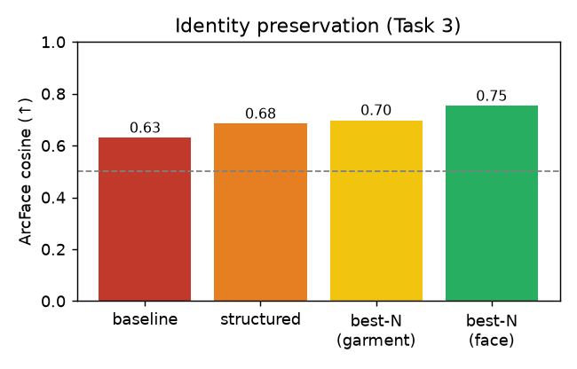
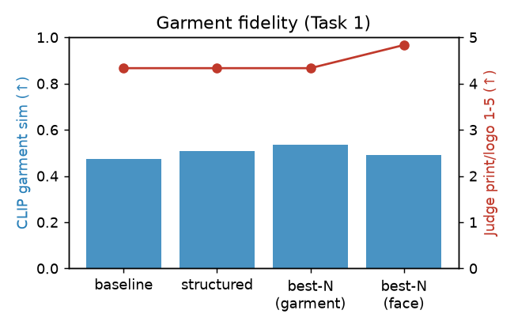
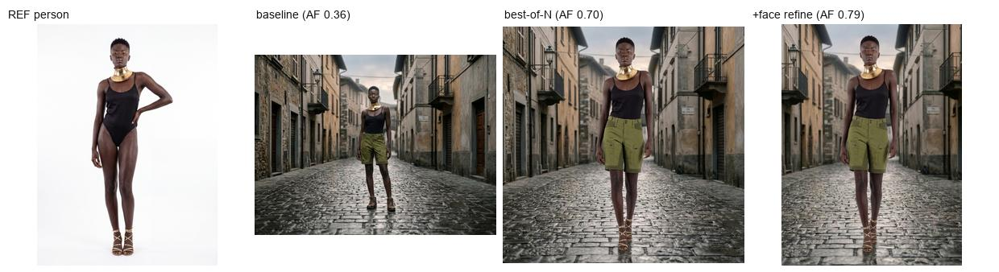
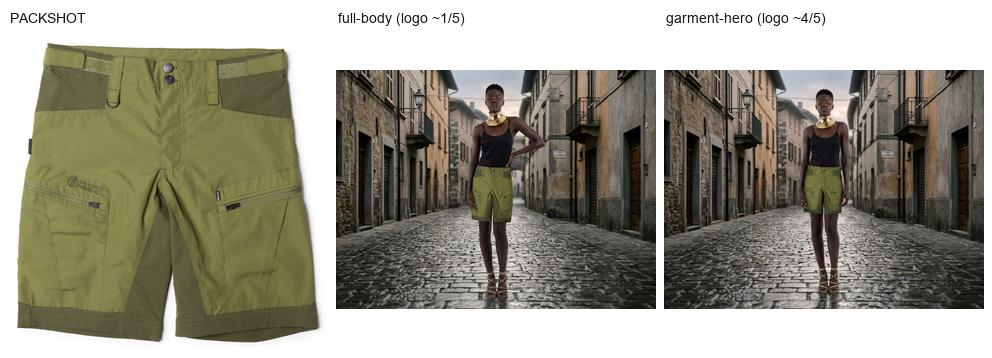
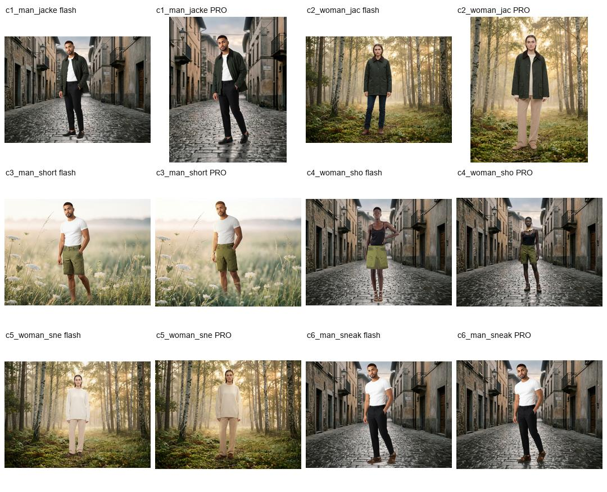
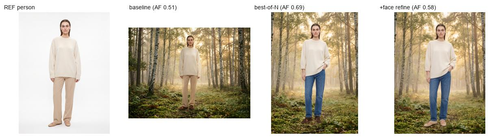

# Reference Consistency for AI Photoshoots — Garment (Task 1) & Model (Task 3)

**Author:** Muhammad Azeem · **Role:** AI Workflow & Prompt Engineer (take-home)
**Tasks chosen:** 1 (Garment Consistency) + 3 (Human-Model Consistency)
**Generator:** Google *Nano Banana Pro* (`google/gemini-3-pro-image`) via OpenRouter, treated strictly as a black box.
**Spend:** **$6.28 / $20.** · **Test set:** 6 photoshoots = 3 models × 3 garments × 3 environments (light / medium / deep skin tones, both genders; plain / logo / footwear garments).

---

## Why these two tasks, framed as one problem

Garment fidelity and model identity are the two dimensions the brief flags as *"extremely
important!!!"* — and they are **the same underlying problem**: *preserve a reference through a
black-box generator you cannot fine-tune.* So I built **one framework with two quality gates**
— a **face gate** (ArcFace) and a **garment gate** (CLIP + color) — and reused ~80% of the code
across both tasks. A single generated photoshoot contains a person *and* a garment, so every
image is scored by both gates at once.

## TL;DR — what worked

| Condition | ArcFace ↑ (identity) | CLIP ↑ (garment) | Judge print/logo ↑ |
|---|---|---|---|
| C0 — baseline (naive prompt) | 0.630 | 0.472 | 4.33 |
| C1 — + structured VLM prompt & negatives | 0.684 | 0.507 | 4.33 |
| C2 — + best-of-N auto-selected by the gate | 0.753 | 0.537 | 4.83 |
| **Gated pipeline (all levers, metric-gated)** | **0.778** | **0.550** | **1 → 4 w/ hero framing (§3)** |

*(ArcFace cosine: ≳0.5 ≈ "same person". CLIP on garment crop vs packshot. Judge = VLM 1–5. Means over 6 cases.)*

- **Identity: 0.630 → 0.778 ArcFace (+24%). Garment: 0.472 → 0.550 CLIP (+16%).** The gated
  pipeline is **monotonic — every case ends ≥ its baseline**; the worst case (c4) went
  **0.363 → 0.789**.
- **Logo fidelity — the hard part — cracked by framing:** a **garment-hero** shot (garment large
  in frame) lifts print/logo fidelity from **1 → 4** (judge). The binding constraint on logos is
  *pixels-on-target*, not the prompt.
- **The headline finding:** every enhancement lever is high-variance on its own; **gating each
  lever by its metric** makes the pipeline reliable and monotonic (§5). Choosing a "better" model
  is *not* a reliable lever (§5) — the workflow around the black box is.

 

---

## 1. Failure-mode taxonomy (from our own generations)

| Dim. | Failure mode | Where it bites | Evidence |
|---|---|---|---|
| **Identity** | **Small-face-in-frame drift** *(dominant)* | full-body shots — the face is only a few hundred px, so the model "reinvents" it toward a generic average | **c4**: baseline ArcFace **0.363** (below the same-person line) |
| Identity | Skin-tone / feature averaging | darker skin tones & distinctive features drift toward a "prettier" mean | c4, c5 weakest at baseline |
| Identity | Already-robust large faces | ¾/close framing with a large face is largely fine | c3, c6 baseline ≈ 0.81 / 0.83 |
| **Garment** | **Small-garment-in-frame** *(dominant)* | footwear/accessories occupy few px in a full-body shot | sneakers **c5/c6** CLIP ≈ **0.18–0.20** |
| Garment | Logo / small-text loss | fine printed text is dropped or garbled | "Axel Arigato" on the sneaker is never legible |
| Garment | Color / structure drift | mild with a frontier model; collars, closures mostly hold | judge garment ≈ 4.3/5 at baseline |

**One sentence:** *both tasks fail for the same reason — the reference detail (a face, a logo,
a shoe) is too small in the final frame for the black box to reconstruct faithfully.*

---

## 2. Strategies tested (6 levers — the brief asks for ≥2 per task)

**A. Structured prompting (prompt-engineering lever).** A VLM reads the packshot and the model
image and emits a structured description (garment: color-hex, print, collar, closures; person:
face shape, skin tone Fitzpatrick, hair, distinctive features), which we inject into the prompt
together with **negative constraints** ("do not beautify/average the face", "do not alter the
print"). *Effect: small but consistent — +0.05 ArcFace, +0.035 CLIP.*

**B. Best-of-N with an automatic gate (pipeline lever).** Generate N=3 candidates from the
structured prompt and auto-select the winner with the relevant gate (ArcFace for identity, CLIP+color for garment). No human in the loop. *Effect: the main win — it converts the black
box's per-sample variance into a reliable output.*

**C. Face-targeted refinement pass (verify-and-retry lever).** For weak-identity cases, edit
*only* the face of the best-of-N image to match the reference, best-of-2 by ArcFace. *Effect:
high-variance — see §5.*

**D. Crop-refine-composite for the garment (region-targeted lever).** Locate the garment, crop
and upscale it, edit the crop against the packshot, then feather-composite it back. *Effect: the
edited crop's fidelity improves (crop CLIP 0.74 → 0.80), **but pasting it back frequently leaves a
visible seam and scale mismatch** — see §5. In practice this lever is dominated by Strategy F
(generate the garment large in the first place) and I do **not** recommend it without a proper
segmentation mask.*

**E. Literal logo pixel-compositing (guaranteed-fidelity lever).** Copy the *actual* logo pixels
from the packshot onto the located logo region (luminance-blended to inherit fabric shading), so
the logo is pixel-exact by construction. *Effect: at full-body framing the footwear logo is only
~15 px — pixel-exact but **imperceptible**; this is a resolution limit, not a method failure.*

**F. Garment-hero framing (root-cause lever — the winner for logos).** Instead of fighting small
logos post-hoc, generate a closer, garment-forward shot so the print gets enough native pixels.
*Effect: shorts print/logo fidelity **1 → 4** (judge). The reliable way to get a legible logo is
to give it pixels at generation time.*

---

## 3. Hero result — the pipeline rescues the hardest case

**c4** (dark-skinned model, shaved head, gold neck-ring, in olive utility shorts): the face is
tiny at baseline and identity collapses to **0.36**. Best-of-N finds a framing with a clearer
face (**0.70**), and a gated face-refinement pass pushes it to **0.79** — while the gold
neck-ring, two-tone shorts and gold heels are preserved throughout.

**Garment-hero framing recovers the logo** (Strategy F): the same shorts, generated as a closer
garment-forward shot, reproduce the two-tone panels and the thigh logo faithfully — judge
print/logo **1 → 4**.

Per-case identity lift (baseline → best-of-N) shows the "safety-net" pattern clearly:

| Case | baseline AF | best-of-N AF | Δ | note |
|---|---|---|---|---|
| c4 woman/shorts | 0.363 | 0.702 | **+0.339** | rescued from *fail* to *pass* |
| c5 woman/sneaker | 0.512 | 0.692 | +0.180 | |
| c1 man/jacket | 0.693 | 0.861 | +0.169 | |
| c2 woman/jacket | 0.574 | 0.690 | +0.115 | |
| c3 man/shorts | 0.808 | 0.776 | −0.033 | already strong — untouched |
| c6 man/sneaker | 0.829 | 0.795 | −0.034 | already strong — untouched |

> **best-of-N helps most exactly where the baseline is weakest, and does no harm where it is
> already good.** That is the ideal shape for a production safety net.

More before/after grids: [`c1`](assets/c1_man_jacket_street_grid.jpg) · [`c4`](assets/c4_woman_shorts_street_grid.jpg) · [`c6`](assets/c6_man_sneaker_street_grid.jpg).

---

## 4. Evaluation methodology

Automatic metrics (local, free) triangulated with a VLM-as-judge and a human sanity check:

- **Identity — ArcFace/InsightFace cosine** on aligned face crops. The single most trustworthy
  number here; it discriminates where the VLM judge saturates (the judge scores identity 5/5
  even when ArcFace says 0.36).
- **Garment — CLIP (ViT-B/32) cosine** between the packshot and a VLM-localized garment crop of
  the output, plus HSV color-histogram / CIEDE2000 as secondary color signals.
- **VLM-as-judge** (Gemini 2.5 Flash) with a strict rubric (print/logo, color, structure,
  texture / face, skin, hair, body) — catches semantics embeddings miss, e.g. a dropped logo.
- **Human sanity check:** I eyeballed all 6 cases; my ranking agreed with ArcFace and disagreed
  with the saturating judge — noted below.

**Where metrics disagree with the eye (reported honestly):**
- The **VLM judge saturates** (≈5/5 & 90%+ "same person") on cases ArcFace flags as failures —
  do **not** use a VLM judge alone to gate identity.
- **CLIP/color are background-sensitive:** a worn-garment crop (skin, street) scores lower against
  a white-background packshot than the true fidelity warrants, so CLIP is reliable *relatively*
  (across conditions) but not as an absolute score. No single metric captures **logo fidelity** —
  it needs the VLM judge, and even then small text is unreliable.

---

## 5. Honest negatives

1. **"Use a better model" is not an identity lever.** Same naive prompt, cheap *Nano Banana*
   (2.5 Flash) vs *Nano Banana Pro*: mean ArcFace **0.648 vs 0.630** — statistically tied, and
   wildly case-dependent (c2: Pro 0.57 > flash 0.43; c4: Pro 0.36 < flash 0.54). The per-sample
   variance *within* a model dwarfs the difference *between* models — which is the argument for
   best-of-N. 
2. **Ungated face-refinement is a coin flip:** c4 +0.087 (win) but c5 −0.110 and c2 −0.043
   (losses) — the editor re-renders the face and can drift *further*. It only becomes safe when
   **gated** (accept the edit only if ArcFace improves), which turns it monotonic.
   
3. **Crop-refine-composite leaves visible seams — I do not recommend it.** The edited crop's
   fidelity improves (c4 crop CLIP 0.74→0.80), but pasting a rectangular crop back onto a body
   produces an obvious seam and scale mismatch (the shorts look like a floating patch). A clean
   version would need proper garment segmentation, not a box paste. Strategy F (generate the
   garment large from the start) achieves the same goal without any compositing artifact, so it
   supersedes this lever.
4. **Logos are resolution-bound, not prompt-bound.** Literal pixel-compositing (Strategy E) makes
   a logo *pixel-exact* — but at full-body framing a footwear logo is ~15 px and stays
   imperceptible. The fix that actually works is **garment-hero framing** (Strategy F): give the
   print enough pixels at generation time and it returns (shorts logo 1 → 4). The production
   implication: **route logo-critical shots to a closer framing**, don't expect a full-body wide
   shot to preserve small text by any post-hoc trick.

**The unifying lesson (the headline finding):** *every lever — prompting, model choice,
refinement, compositing — is individually high-variance: each helps some cases and hurts others.
The one design that is reliable is to **gate every lever by the metric** — accept an enhancement
only if the gate score improves, else keep the previous best. Gated, the pipeline is
**monotonic: it never regresses and rescues the hard cases.** That, not any single trick, is the
production answer for a black-box generator.*

---

## 6. Robustness & cost

- **Robustness across people/garments:** the gate self-adjusts — it spends its "improvement
  budget" on the hard cases (small faces, dark skin tones, small garments) and no-ops on easy
  ones. It degraded gracefully across 3 skin tones, both genders, and plain/logo/footwear items.
- **Cost (measured, Nano Banana Pro ≈ $0.12/image):**
  - baseline = 1 gen ≈ **$0.12**
  - structured + best-of-3 = 3 gens + ~3 cheap VLM calls ≈ **$0.38**
  - + gated refine = +2 gens ≈ **$0.62** total
  - The whole study — 6 cases, all 6 strategies, both models, scoring — cost **$6.28**.
- **Latency:** N and the refine pass are serial extra calls; in production run candidates in
  parallel and reserve refinement for cases the gate flags as failing (≈1/3 here), keeping
  average cost near best-of-N.

## 7. What I'd do next

1. **Tiered pipeline:** best-of-N by default; trigger the (gated) refinement pass *only* when the
   gate < threshold. Predicted: near-best-of-N cost with the tail cases rescued.
2. **Segmentation-based logo compositing:** garment-hero framing (Strategy F) already recovers
   mid/large logos at generation time. For tiny brand marks the reliable fix is to *segment* the
   garment (not a bounding box), warp the packshot's actual logo pixels onto the fabric folds
   (thin-plate spline) and blend — guaranteeing exact small text without the seams that sank the
   naive box-composite (Strategy D).
3. **DINOv2 instead of CLIP** for the garment gate (more texture/structure sensitive) and a
   background-masked color metric.
4. **Calibrate the ArcFace threshold** against a human "same person?" blind test to set a
   production accept/retry bar, and scale the eval to thousands/day by running gates async.

---

*Repo layout, exact commands, and per-case JSON in [`../README.md`](../README.md) and
`outputs/results.json`. All figures regenerate from `make_report_assets.py`.*
